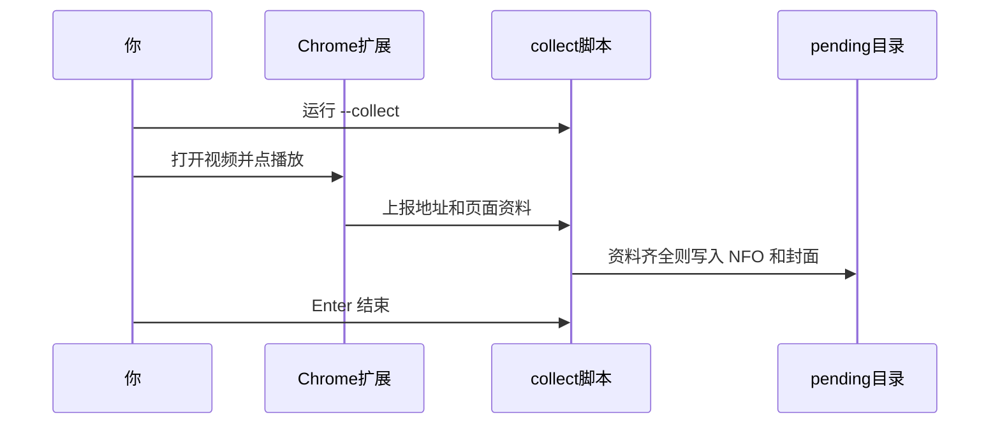
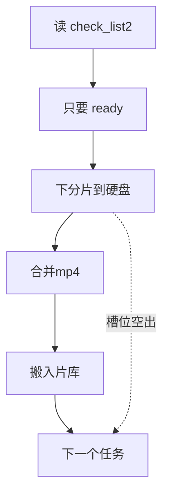

# MissAV 视频采集下载

## 解决了missav不能使用各种工具下载的问题
- 仓鼠症朋友们又有救了
- missav不能下载的原因，经鉴定之后是因为nurrit的反爬问题，本工具通过获取浏览器中uuID的形式解决了此问题
- 这是一个单机小工具：Chrome 里点播放，扩展自动把地址和页面资料记下来；有空再批量下成 mp4
- 采集在你自己的 Windows 电脑上。下载可以在这台电脑上跑，也可以在 NAS 上跑
- 开 MissAV 需要梯子，下载不需要梯子
- 刮削已经能用！采集时就会写好 NFO 和封面，不需要再靠别的刮削器
- JAVSP可以作为补充，但是确实没必要再折腾一次了！

---

## 使用指南

0. **前置**：安装依赖 + ffmpeg（合并 mp4 用，需在 PATH 里能直接跑 `ffmpeg`）
1. **Chrome 扩展**：`chrome://extensions` → 开开发者模式 → 「加载已解压的扩展程序」→ 选本仓库 `chrome_extension` 文件夹
2. **采集**
   1. 准备好要下载的 tab，用 Chrome 统一打开之后，关掉所有页面
   2. 终端执行：`python download_missav.py --collect`
   3. 重新打开所有 tab（`Ctrl+Shift+T`）
   4. 逐个点播放。资料齐全会写入 `pending/{番号}/`，终端标为 `ready`
   5. 采完后按 Enter 结束采集
   6. 如果没有嗅探到：先点一下播放；还不行请提交 issue，我看看是不是出了新格式
3. **下载**：`python download_missav.py --download-only`（[NAS 上跑点这里](#nas-download)）
4. 改过扩展后，到 `chrome://extensions` 点「重新加载」
### 关于参数的问题请去问你的 AI
---

## 我最后决定让AI写一个详细介绍
**但是我依然建议你直接问你的AI比较好**

## 第一步：采集

```powershell
pip install -r requirements.txt
python download_missav.py --collect
```

1. Chrome 打开 MissAV 影片页，**点一下播放**
2. 扩展抓到 m3u8，并读取页面上的标题、女优、类型、日期、简介、发行商和封面
3. 这些都有时，写入 `pending/{番号}/`，清单标为 `ready`
4. 缺任何一项则标为 `incomplete`，不会下载
5. 采够了，回终端按 **Enter** 结束

`pending/{番号}/` 里会有：

- `movie.nfo`
- `poster.jpg`、`fanart.jpg`
- `metadata.json`
- `job.json`

导演、男优、标签、日文标题、系列，页面上有就会写上。女优名如果带括号，括号里的别名会去掉。有「显示更多」时，扩展会先点开再读简介。



---

## 第二步：下载

```powershell
python download_missav.py --download-only
```

只下载清单里 `ready`、并且 `pending/{番号}/` 已经有 NFO 和封面的条目。

- 默认最多同时下 4 个视频，每个视频 20 个分片线程
- 视频先下到 `.env` 里的 `DOWNLOAD_DIR`（硬盘）。没配则落在项目内 `downloads/`
- 下完一个会马上合并 mp4，**需要 ffmpeg**；合并时下载槽可以接下一个
- 合并后把时长写进 NFO，再把 `pending/{番号}/` 整夹搬到 `{JAV_LIBRARY_DIR}/JAV/{女优}/[番号] 标题/`
- 片库目录在 `.env` 的 `JAV_LIBRARY_DIR`。NAS 上跑则用 `NAS_DOWNLOAD_DIR` 和 `NAS_JAV_LIBRARY_DIR`
- 默认开进度页，终端会打印地址，自己点开即可（一般是 `http://127.0.0.1:8777`）
- 不想要网页：加 `--no-web`

NAS 上跑见 [NAS 下载](#nas-download)。



---

<a id="nas-download"></a>

## NAS 下载

采集还是在 Windows 上做。下载改到 NAS 宿主机跑 `download_missav_nas.py`。

NAS 上用 Python urllib 拉分片。系统 curl 容易被 Cloudflare 403。

`.env` 要填：

- `NAS_DOWNLOAD_DIR`：下载用的硬盘目录
- `NAS_JAV_LIBRARY_DIR`：片库

SSH 前台跑，断开就会停。批量用 nohup：

```bash
ssh user@<NAS地址>
cd /path/to/download_from_missav
mkdir -p logs
nohup python3 -u download_missav_nas.py --download-only \
  >> logs/missav_nas_$(date +%Y%m%d_%H%M%S).log 2>&1 &
echo "started pid $!"
```

进度页：`http://<NAS地址>:8777`

本机 `--collect` 更新清单之后，要重启这个进程才会吃到新条目。更细的说明在 `download_missav_nas.py` 文件最上面。

[回到使用指南](#使用指南)

---

### 任务状态（中断了也不怕）


`incomplete` 不会进入下载。补全页面资料后重新采集，才会变成 `ready`。

下次再跑时的优先顺序：

1. `download_done` → **只合并**，不再下分片
2. `downloading` → **接着下**
3. `ready` → 新任务

---

## 常用参数

| 参数 | 干啥用 |
|------|--------|
| `--workers 20` | 每个视频分片线程数（默认 20） |
| `--parallel 4` | 同时下载几个视频（默认 4） |
| `--max-segments 5` | 只下前几片，测通流程用，不入库 |
| `--no-web` | 关掉进度页 |
| `--web-port 8777` | 改进度页端口 |
| `--output 某目录` | 换视频临时目录（默认 `.env` 的 `DOWNLOAD_DIR`） |
| `--check-list 路径` | 换 checklist JSON（默认 `check_list2.json`） |
| `--keep-segments` | 合并后保留分片目录（默认删） |
| `--no-shelve` | 下完不搬入片库 |
| `--url URL --uuid UUID` | 单条下载，跳过采集清单 |
| `--title 标题` | 配合 `--url --uuid` 指定文件名 |

---

## 文件大概长什么样

| 东西 | 说明 |
|------|------|
| `chrome_extension/` | Chrome 扩展 |
| `pending/{番号}/` | 采集定稿的 NFO 和封面（已 gitignore） |
| `check_list2.json` | 采集清单（本机文件，已 gitignore） |
| `.env` | 本机路径（由 `.env.example` 生成，勿提交） |
| `.env.example` | 配置模板（可提交） |
| `missav.ws_cookies.txt` | Cookie |

`.env` 里要填的路径：

| 配置 | 用途 |
|------|------|
| `DOWNLOAD_DIR` | 本机下载用的硬盘目录 |
| `JAV_LIBRARY_DIR` | 本机片库 |
| `NAS_DOWNLOAD_DIR` | NAS 下载用的硬盘目录 |
| `NAS_JAV_LIBRARY_DIR` | NAS 片库 |

`pending/` 不用配，就在项目目录里。

---

## 一句话上手

```powershell
pip install -r requirements.txt
# 确保 ffmpeg 在 PATH；Chrome 加载 chrome_extension
python download_missav.py --collect          # 点播放，顺手刮削
python download_missav.py --download-only    # 有空再下，下完入库
```

更细的终端说明写在 `download_missav.py` 文件最上面。

---

## 免责声明

本工具仅供个人学习与技术研究。请遵守所在地法律法规及目标网站服务条款，勿用于任何侵权或商业用途。下载什么、存哪里、怎么用，你自己决定并自行承担后果。
